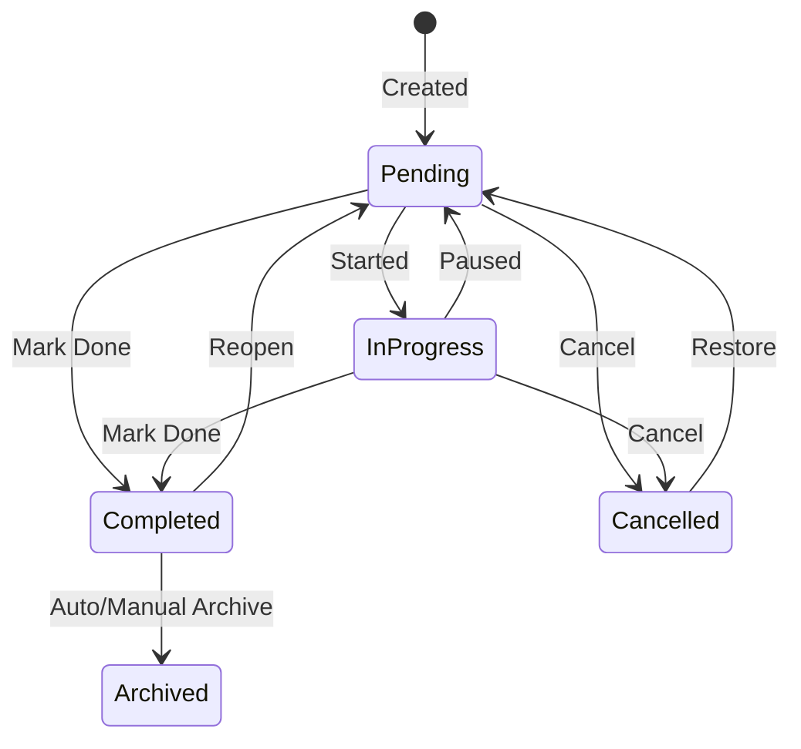

# DailyFlow Task Domain Specifications

This skill defines the business logic, state machines, recurrence algorithms, and scheduling invariants for the **DailyFlow** task management system.

## Invariant Rules (Non-Negotiable)

1. **User Data Isolation**: Every task, subtask, project, and reminder is strictly owned by one user. No query or mutation may cross tenant boundaries.
2. **Idempotent Recurring Tasks**: Recurring tasks MUST NEVER generate duplicate occurrences. Scheduling triggers and completion handlers must use deterministic keys or transaction-locked sequence guards.
3. **Timezone-Agnostic Calendar Dates**: Date-only tasks (tasks without a specific clock time) are calendar dates (`YYYY-MM-DD`). They must NOT be shifted by UTC offsets when viewed in different timezones.
4. **Deterministic Overdue & Today Calculations**: "Today" and "Overdue" are calculated relative to the user's configured local timezone at the moment of evaluation.
5. **Predictable Completion Flow**: Completing a task marks `completed_at = now()`, updates status, and recalculates parent project / daily progress metrics. Reopening clears `completed_at` and restores progress state.

---

## Task Priorities & Weights

| Priority | Key      | Visual Indicator | Default Sort Weight | Description |
| :------- | :------- | :--------------- | :------------------ | :---------- |
| Urgent   | `urgent` | Red / Flagged    | 40                  | Requires immediate attention |
| High     | `high`   | Amber            | 30                  | Critical for the current day / milestone |
| Medium   | `medium` | Blue             | 20                  | Standard daily task (Default) |
| Low      | `low`    | Gray / Muted     | 10                  | Optional or backlog task |

---

## Task Lifecycle State Machine

---

## Core Domain References

For comprehensive algorithms, recurrence models, and timezone calculations, refer to:

- [Lifecycle & Recurrence Guide](./references/lifecycle-and-recurrence.md): Detailed state transitions, idempotent recurrence generation, subtask cascades, and completion events.
- [Timezone & Progress Metrics](./references/timezone-and-progress.md): Timezone-agnostic dates vs timestamped reminders, overdue calculation formulas, daily velocity, and progress tracking.
