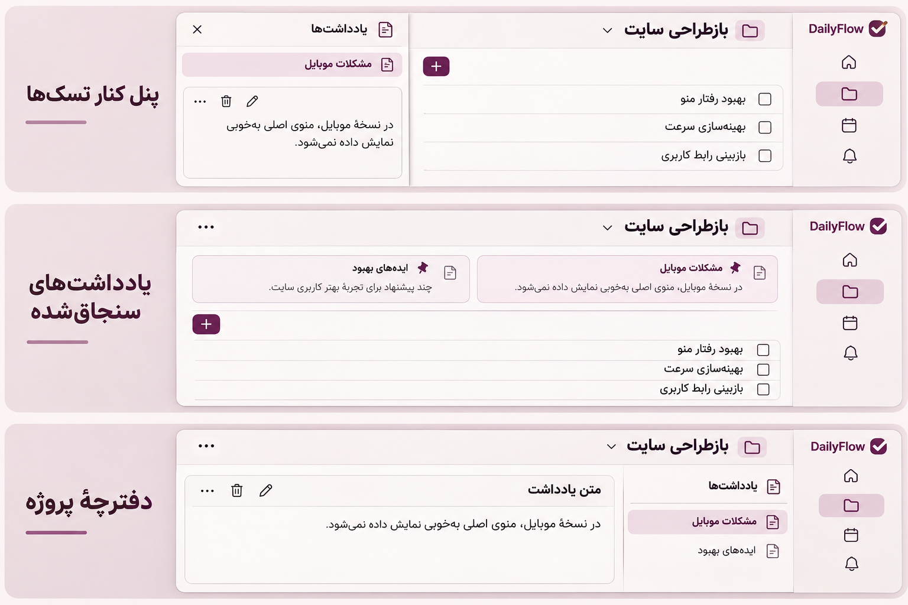
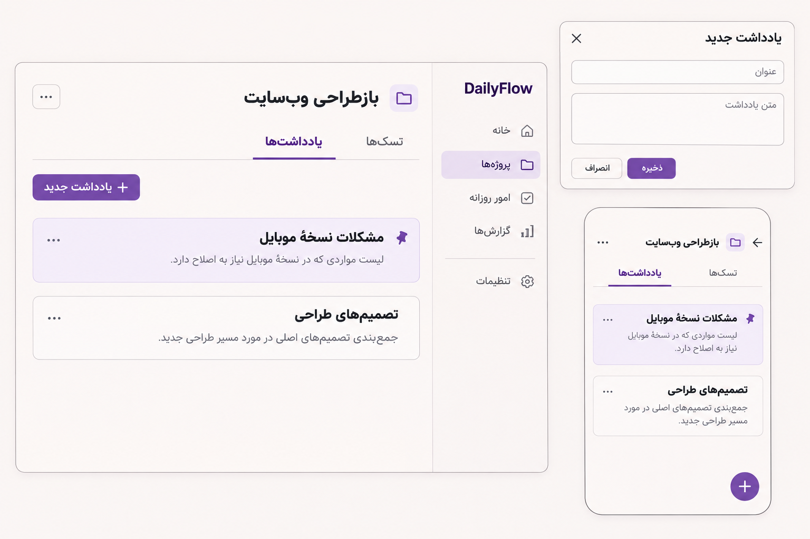

# طراحی یادداشت‌های پروژه در DailyFlow

پیشنهاد این است که صفحهٔ هر پروژه یک تب «یادداشت‌ها» کنار «تسک‌ها» داشته باشد. کاربر می‌تواند برای هر پروژه چند متن مستقل برای ثبت مشکلات، تصمیم‌ها، نکات بررسی یا کارهایی که هنوز به تسک تبدیل نشده‌اند نگه دارد.

برای نمونه، در پروژهٔ «بازطراحی وب‌سایت» کاربر یادداشت «مشکلات نسخهٔ موبایل» را می‌نویسد و سنجاق می‌کند. وقتی یکی از موارد به اقدام مشخص رسید، تسکی مثل «اصلاح جای دکمهٔ خرید در موبایل» در همان پروژه می‌سازد و برایش موعد تعیین می‌کند.

## گزینه‌های طراحی

| گزینه | کاربرد و هزینه |
| --- | --- |
| گسترش توضیح پروژه | یک جای ساده برای معرفی یا یک متن ثابت. با طولانی شدن متن، ویرایش موضوعات مستقل و پیدا کردن نکتهٔ مهم دشوارتر می‌شود. |
| یک سند متنی برای هر پروژه | برای گزارشی که پیوسته نوشته و خوانده می‌شود مناسب است. پیدا کردن چند موضوع مستقل به عنوان‌بندی و جست‌وجوی داخل متن وابسته می‌شود. |
| **چند یادداشت در یک تب پروژه** | هر موضوع عنوان، متن و زمان ویرایش خودش را دارد و مستقل سنجاق می‌شود. به مدل داده و عملیات ذخیره‌سازی جدا نیاز دارد. این گزینه برای مثال‌های مطرح‌شده پیشنهاد می‌شود. |

## سه چیدمان جایگزین

- **پنل کنار تسک‌ها.** دکمهٔ «یادداشت‌ها» یک پنل جمع‌شدنی سمت چپ باز می‌کند. کاربر می‌تواند هم‌زمان متن «مشکلات موبایل» را بخواند و تسک‌های اصلاحی را ثبت کند. در دسکتاپ عریض، فهرست و پنل کنار هم جا می‌شوند. روی موبایل و در کانبان کم‌عرض، پنل روی محتوا باز می‌شود تا ستون‌ها فشرده نشوند.
- **یادداشت‌های سنجاق‌شده بالای تسک‌ها.** حداکثر دو یادداشت مهم زیر سربرگ پروژه به‌صورت عنوان و پیش‌نمایش کوتاه دیده می‌شوند. لینک «همهٔ یادداشت‌ها» فهرست کامل را باز می‌کند. این چیدمان برای نکته‌ای مناسب است که باید به محض ورود به پروژه دیده شود. وقتی یادداشت سنجاق‌شده‌ای وجود ندارد، این ردیف نمایش داده نمی‌شود.
- **دفترچهٔ پروژه.** با باز کردن تب، عنوان یادداشت‌ها در سمت راست و متن یادداشت انتخاب‌شده در فضای بزرگ سمت چپ دیده می‌شود. در موبایل ابتدا فهرست باز می‌شود و با انتخاب عنوان، کاربر به متن می‌رود. این چیدمان برای گزارش بررسی طولانی، ثبت تصمیم‌ها و مرور چند متن پشت سر هم مناسب است.

برای استفاده‌ای که مطرح شد، **تب طرح اول همراه با پیش‌نمایش جمع‌وجور یادداشت‌های سنجاق‌شده** پیشنهاد می‌شود. این ترکیب یک جای مشخص برای همهٔ متن‌ها دارد و نکته‌ای مثل «قبل از انتشار، نسخهٔ موبایل بررسی شود» را در نمای تسک‌ها هم در معرض دید قرار می‌دهد. سه تصویر مفهومی‌اند و قرارداد داده و API برای هر سه چیدمان قابل استفاده است.

## تجربهٔ کاربری نسخهٔ اول

1. در صفحهٔ فعلی پروژه، تب «تسک‌ها» به‌طور پیش‌فرض باز است. توضیح کوتاه و نوار پیشرفت در سربرگ پروژه دیده می‌شوند و سوییچ «فهرست / کانبان» داخل تب تسک‌هاست. تب یادداشت‌ها با `?tab=notes` قابل باز کردن است.
2. تب «یادداشت‌ها» دکمهٔ «یادداشت جدید» و فهرست کارت‌ها را نشان می‌دهد. هر کارت عنوان، خلاصهٔ متن و تاریخ آخرین ویرایش دارد. یادداشت‌های سنجاق‌شده اول می‌آیند و هر گروه بر اساس آخرین ویرایش مرتب می‌شود. انتخاب عنوان، متن کامل را باز می‌کند.
3. در دسکتاپ ایجاد و ویرایش در یک دیالوگ انجام می‌شود. در موبایل همان فرم تمام‌عرض باز می‌شود. فرم عنوان و متن چندخطی، دکمهٔ «ذخیره» و «انصراف» دارد. هنگام ارسال، دکمه غیرفعال است. در خطای ثبت، متن تایپ‌شده حفظ و خطا کنار فیلد یا فرم نمایش داده می‌شود. خروج با تغییرات ذخیره‌نشده تأیید می‌خواهد.
4. منوی هر کارت شامل «ویرایش»، «سنجاق کردن / برداشتن سنجاق» و «حذف» است. حذف پس از تأیید انجام می‌شود. فهرست خالی پیام «هنوز یادداشتی برای این پروژه ثبت نشده» و دکمهٔ افزودن دارد. خطای دریافت فهرست دکمهٔ «تلاش دوباره» دارد.
5. تب‌ها و منوها با صفحه‌کلید قابل استفاده‌اند. دیالوگ تمرکز را در خودش نگه می‌دارد و پس از بسته شدن، تمرکز به دکمه‌ای برمی‌گردد که آن را باز کرده است. فرم و کارت‌ها با طراحی راست‌به‌چپ، تم روشن و تاریک و مؤلفه‌های فعلی DailyFlow هماهنگ می‌شوند.

در تصویر، سمت چپ فهرست دسکتاپ است، بالا سمت راست فرم ثبت و پایین سمت راست نمای موبایل. در پیاده‌سازی، سربرگ، منوی اصلی، فاصله‌ها و رنگ‌ها از خود DailyFlow گرفته می‌شوند. تصویر چیدمان پیشنهادی را نشان می‌دهد.

روی هر کارت، کنترل «وضعیت بررسی» یکی از سه مقدار «بررسی نشده»، «در حال بررسی» و «بررسی انجام شد» را نشان می‌دهد. یادداشت‌های موجود و جدید از «بررسی نشده» شروع می‌شوند و می‌توان وضعیت را در هر جهت تغییر داد.

## روش پیاده‌سازی

### Laravel و داده

- جدول `project_notes` با `id` داخلی، `uuid` یکتا برای API، `project_id` به‌عنوان کلید خارجی، `title`، `body`، `pinned_at` اختیاری و زمان‌های ایجاد و ویرایش. مالکیت از رابطهٔ پروژه به کاربر به دست می‌آید. برای فهرست و ترتیب، ایندکس مناسب روی پروژه، وضعیت سنجاق و زمان ویرایش اضافه شود.
- عنوان و متن پس از trim الزامی‌اند. سقف پیشنهادی ۱۲۰ نویسه برای عنوان و ۱۰٬۰۰۰ نویسه برای متن است. متن ساده با حفظ خط‌های جدید ذخیره و با interpolation استاندارد Vue نمایش داده شود.
- خواندن و تغییر یادداشت به پروژهٔ کاربر جاری محدود باشد. پس از مجوز دسترسی به پروژه، یادداشت فقط از رابطهٔ `project->notes()` پیدا شود تا UUID یادداشت پروژهٔ دیگر در مسیر پذیرفته نشود. بدنهٔ درخواست فقط فیلدهای قابل ویرایش را می‌پذیرد.
- حذف پروژه باید یادداشت‌های همان پروژه را با خود پروژه حذف کند، مستقل از گزینهٔ نگه‌داشتن تسک‌های آن. اگر پروژه با soft delete حذف می‌شود، این رفتار در Action حذف پروژه و در تراکنش آن اعمال شود. برای پروژه‌های موجود، تب ابتدا فهرست خالی دارد و migration نیاز به انتقال توضیحات قبلی ندارد.
- خروجی دادهٔ کاربر، یادداشت‌ها را همراه UUID پروژه در JSON و CSV در بر بگیرد. برای متن فارسی چندخطی، escaping و بازیابی صحیح CSV تست شود.

### قرارداد API

مسیر پایه `/api/v1/projects/{project:uuid}/notes` است و از Sanctum استفاده می‌کند.

| درخواست | رفتار |
| --- | --- |
| `GET /notes` | فهرست یادداشت‌ها با ترتیب مشخص و صفحه‌بندی. |
| `POST /notes` | ایجاد با `title` و `body` و پاسخ `201`. |
| `PATCH /notes/{note:uuid}` | ویرایش عنوان، متن، وضعیت بررسی (`review_status`) یا تنظیم صریح `is_pinned`. درخواست تکراری سنجاق، آن را از حالت سنجاق خارج نمی‌کند. |
| `DELETE /notes/{note:uuid}` | حذف پس از احراز مجوز و پاسخ `204`. |

در جدول، مسیرهای کوتاه پس از `/api/v1/projects/{project:uuid}` قرار می‌گیرند. پاسخ اعتبارسنجی از الگوی `422` موجود پیروی کند. یادداشت خارج از پروژهٔ مسیر با `404` پاسخ داده شود.

### Vue و ترتیب اجرا

1. مدل، رابطه و migration را اضافه کنید. ابتدا با Pest سناریوهای مالکیت، شناسهٔ متعلق به پروژهٔ دیگر، اعتبارسنجی، ترتیب سنجاق، حذف پروژه و خروجی داده را پوشش دهید.
2. API و Resource را بسازید. خواندن و تغییر داده در مسیرهای تحت احراز هویت انجام شود.
3. در `ProjectDetailView.vue` کنترل انتخاب تب را اضافه کنید. مؤلفه‌های `ProjectNotesPanel` و `ProjectNoteEditor` فهرست و فرم را نگه دارند. دادهٔ یادداشت‌ها هنگام ورود به تب واکشی و بر اساس UUID پروژه جدا شود. با تعویض پروژه، درخواست قبلی لغو شود یا پاسخ دیرهنگام کنار گذاشته شود.
4. مسیر ایجاد، ویرایش، خواندن، سنجاق و حذف را در دسکتاپ و موبایل بررسی کنید. بازخوانی صفحه باید تب و یادداشت‌های ذخیره‌شده را بازیابی کند. یک تست مرورگری جریان ایجاد تا بازخوانی را بپوشاند و باقی ماندن عملکرد فهرست و کانبان پروژه هم بررسی شود.

تبدیل یادداشت به تسک، ویرایشگر غنی، پیوست و جست‌وجوی سراسری یادداشت‌ها برای نسخه‌های بعدی قابل بررسی‌اند. در نسخهٔ اول کاربر می‌تواند مستقیماً از تب تسک‌ها اقدام موردنظرش را ثبت کند.

## نمونه‌های واقعی

### Asana و Project Brief

در تب Overview، توضیح پروژه و Project Brief برای ثبت زمینهٔ کار در دسترس‌اند. این نمونه نشان می‌دهد چطور محتوای متنی در خود پروژه پیدا می‌شود. [راهنمای رسمی Asana](https://help.asana.com/s/article/project-overview-tab)

### Trello و About this board

Trello توضیح برد را در بخشی از منوی همان برد قرار می‌دهد. این الگو برای توضیح واحد و کوتاه مفید است و به گزینهٔ «گسترش توضیح پروژه» نزدیک‌تر است. [راهنمای رسمی Trello](https://support.atlassian.com/trello/docs/the-board-menu/#about-this-board)

